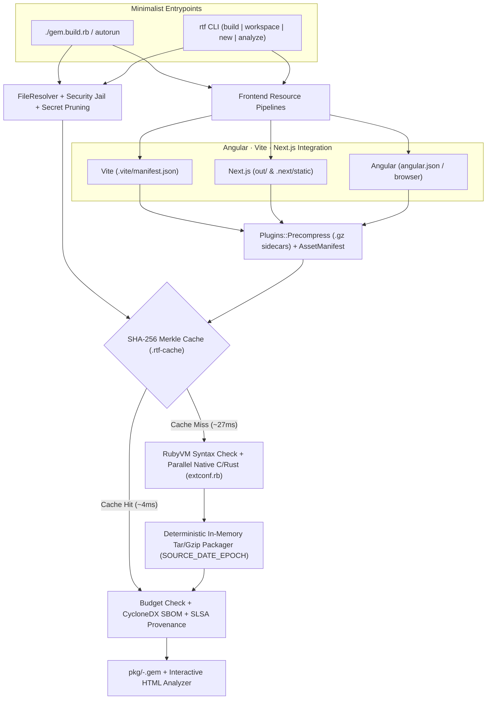
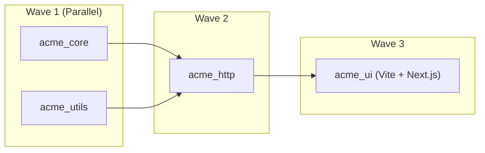

# RubyToFaster (`rtf`)

[](https://github.com/HNMLabs/rubytofaster/actions/workflows/ci.yml)
[](https://www.ruby-lang.org/)
[](sig/rubytofaster.rbs)
[](#why-rubytofaster)
[](LICENSE)
[](https://github.com/HNMLabs/rubytofaster/wiki)

**RubyToFaster** (`rtf`) is a next-generation, zero-dependency, script-first build system for Ruby gems. It executes the package compiler directly as a minimalist Ruby script while bringing modern frontend resource pipelines, incremental Merkle caching, topological monorepo builds, interactive bundle treemaps, and supply-chain provenance from the **Angular**, **Vite**, and **Next.js** ecosystems directly to RubyGems.

---

## Why RubyToFaster?

| Capability | Traditional `rake build` / `gem build` | **RubyToFaster (`rtf`) v0.2** |
| :--- | :--- | :--- |
| **Execution Model** | Requires `Rakefile` + `Bundler::GemHelper` | Standalone Ruby script (`./gem.build.rb`), 1-line `autorun`, or `rtf` CLI |
| **Runtime Dependencies** | Rake, Bundler, task plugins | **Zero** external runtime dependencies (100% Ruby 3.0+ stdlib + RBS types) |
| **Incremental Caching** | Rebuilds `.gem` unconditionally | Content-addressable SHA-256 **Merkle cache** (`.rtf-cache/`) — **~4ms** hits (**~46x faster**) |
| **Monorepo / Workspaces** | Custom shell loops | **Topological DAG Workspace Runner** (`rtf workspace`) building gem waves in parallel |
| **Frontend Resources** | Manual Rake hooks & fragile copy scripts | Native **Vite**, **Next.js**, and **Angular** adapters + `.gz` precompression |
| **Runtime Asset Serving** | Requires custom Rack glue or Node.js | Zero-dep **`RubyToFaster::Middleware`** (immutable cache, `.gz`, ETag, SPA fallback) + **Dev HMR** |
| **Bundle Visibility** | Raw `tar -ztvf` inspection | **`rtf analyze --html`** interactive treemap dashboard (`@next/bundle-analyzer` for gems) |
| **Size Governance** | None | **Angular-style bundle budgets** (`max_compressed_kb`, `max_unpacked_kb`, `max_entry_kb`) |
| **Supply-Chain Security** | Packages whatever matches `spec.files` | Path/symlink jail, secret pruning, **CycloneDX 1.5 SBOM**, **SLSA v1 Provenance** |

---

## Measured Benchmarks (`rtf bench`)

Run `rtf bench` inside any gem repository to measure performance on your own hardware. Measured on Linux (`x86_64-linux-gnu`) packaging `rubytofaster` itself (38 files, SHA-256 + SHA-512 verification):

| Strategy | Mean Latency | Min | P95 | Speedup vs `gem build` |
| :--- | ---: | ---: | ---: | ---: |
| `gem build` (CLI subprocess) | `188.50 ms` | `165.67 ms` | `211.33 ms` | **1.0x** |
| `Gem::Package.build` (in-process, non-sorted) | `27.37 ms` | `24.82 ms` | `33.94 ms` | **6.9x** |
| **RubyToFaster (cold deterministic + syntax check)** | **`27.35 ms`** | **`25.90 ms`** | **`30.68 ms`** | **6.9x** |
| **RubyToFaster (incremental Merkle cache hit)** | **`4.04 ms`** | **`3.82 ms`** | **`4.27 ms`** | **46.7x** |

---

## Architecture Overview



---

## Installation & Scaffolding

```bash
gem install rubytofaster
```

Scaffold a brand-new, zero-Rake, script-first Ruby gem (with RBS signatures and optional **Vite**, **Next.js**, or **Angular** workspaces pre-configured):

```bash
# Pure Ruby micro-gem
rtf new fast_token

# Full-stack Ruby Engine/Dashboard with Vite + Next.js + Angular workspaces
rtf new pulse_studio --fullstack
cd pulse_studio && ./gem.build.rb
```

---

## Minimalist Script Execution

### 1. Zero-Config 1-Liner (`autorun`)

```ruby
#!/usr/bin/env ruby
require "rubytofaster/autorun"
```

### 2. Full-Featured Compiler Script (`gem.build.rb`)

```ruby
#!/usr/bin/env ruby
# frozen_string_literal: true

require "rubytofaster"

RubyToFaster.build(root_dir: __dir__) do |pkg|
  pkg.gemspec "pulse_studio.gemspec"
  pkg.incremental  = true
  pkg.reproducible = true

  # Compile-time RubyVM::InstructionSequence syntax verification (<1ms)
  pkg.validate_ruby_syntax

  # Native frontend resource pipelines
  pkg.vite    root: "frontend", out_dir: "dist", mount_to: "public/vite",    auto_build: true
  pkg.nextjs  root: "portal",   mode: :auto,     mount_to: "public/nextjs",  auto_build: true
  pkg.angular root: "admin",    project: "app",  mount_to: "public/angular", auto_build: true

  # Pre-compress .js/.css/.html/.svg into .gz sidecars for zero-CPU runtime serving
  pkg.precompress_assets

  # Generate zero-dependency Ruby helper with Dev-Server HMR & production manifest lookup
  pkg.generate_asset_helper(
    module_name: "PulseStudio::Assets",
    path: "lib/pulse_studio/assets.rb"
  )

  # Supply-chain attestations & Angular-style size budgets
  pkg.generate_sbom(embed_in_gem: true)
  pkg.generate_provenance
  pkg.budget max_compressed_kb: 1536, max_unpacked_kb: 6144, max_entry_kb: 512
end
```

---

## Serving Assets in Rack / Rails + Live HMR Development

`RubyToFaster` bridges build time and runtime with **zero external dependencies**:

### 1. Mount `RubyToFaster::Middleware` in Rack / Rails / Sinatra

Serves packaged Vite, Next.js (`/_next/static` & clean exported routes), and Angular (`browser/` SPA history fallback) assets directly from your gem with pre-compressed `.gz` negotiation, `ETag` (`304 Not Modified`), `X-Content-Type-Options: nosniff`, and `Cache-Control: public, max-age=31536000, immutable` on hashed bundles:

```ruby
# config.ru or Rails::Engine initializer
require "rubytofaster"
require "pulse_studio/assets"

use RubyToFaster::Middleware,
    root: File.expand_path("public/vite", __dir__),
    url_prefix: "/pulse/assets",
    spa_fallback: true
```

### 2. Render Tags with Automatic HMR in Development

- **In Development (`RTF_DEV_SERVER=http://localhost:5173`):** Automatically injects `<script type="module" src="http://localhost:5173/@vite/client">` + live module entrypoints for instant Hot Module Replacement!
- **In Production (packaged `.gem`):** Emits fingerprinted `<link rel="stylesheet">` and `<script type="module">` tags from the embedded manifest—**zero Node.js required in production**.

```erb
<%= PulseStudio::Assets.html_tags("src/main.ts", framework: :vite, url_prefix: "/pulse/assets") %>
```

---

## Monorepo Workspaces (`rtf workspace`)

Inspired by Turborepo, Nx, and Angular Workspaces, `RubyToFaster::Workspace` discovers all gems across `gems/*`, `packages/*`, `plugins/*`, and `apps/*`, builds a **topological dependency DAG**, detects circular dependencies, and compiles independent gem waves **in parallel across CPU cores**:



```bash
rtf workspace
# Workspace Build Complete (4 gems in 3 topological waves, 14.20ms)
#   Wave 1: acme_core, acme_utils
#   Wave 2: acme_http
#   Wave 3: acme_ui
```

---

## Interactive Bundle Analyzer (`rtf analyze`)

Audit every byte inside your `.gem`—categorized across Ruby `lib/`, Vite chunks, Next.js bundles, Angular assets, RBS signatures, and `.gz` sidecars—and generate a **self-contained, zero-CDN interactive HTML treemap report**:

```bash
rtf analyze pkg/pulse_studio-0.2.0.gem --html pkg/bundle-report.html
```

---

## CLI Reference (`rtf` / `rubytofaster`)

```bash
rtf [build] [gem.build.rb | *.gemspec] [--no-cache] [--sbom] [--provenance] [-V] [--json]
rtf new <gem_name> [--vite] [--nextjs] [--angular] [--fullstack]
rtf init [--vite] [--nextjs] [--angular]
rtf inspect <pkg/file.gem> [--json]
rtf analyze <pkg/file.gem> [--html report.html] [--json]
rtf workspace [--patterns 'gems/*,packages/*'] [--no-cache] [--json]
rtf bench [-n ITERATIONS] [--json]
rtf watch [gem.build.rb]
rtf doctor
rtf clean
```

---

## Documentation & GitHub Wiki

Explore the complete 12-page **[RubyToFaster GitHub Wiki](https://github.com/HNMLabs/rubytofaster/wiki)**:

- **[Getting Started](https://github.com/HNMLabs/rubytofaster/wiki/Getting-Started)**
- **[Architecture & Compiler Pipeline](https://github.com/HNMLabs/rubytofaster/wiki/Architecture-and-Compiler-Pipeline)**
- **[Frontend Resources: Vite, Next.js & Angular](https://github.com/HNMLabs/rubytofaster/wiki/Frontend-Resources-Vite-Nextjs-Angular)**
- **[Rack Middleware & HMR Dev Mode](https://github.com/HNMLabs/rubytofaster/wiki/Rack-Middleware-and-HMR-Dev-Mode)**
- **[Monorepo Workspaces & DAG Builds](https://github.com/HNMLabs/rubytofaster/wiki/Monorepo-Workspaces-and-DAG-Builds)**
- **[Bundle Analyzer, SBOM & SLSA Provenance](https://github.com/HNMLabs/rubytofaster/wiki/Bundle-Analyzer-SBOM-and-Provenance)**
- **[CLI & Script API Reference](https://github.com/HNMLabs/rubytofaster/wiki/CLI-and-Script-API-Reference)**
- **[Security & Reproducible Builds](https://github.com/HNMLabs/rubytofaster/wiki/Security-and-Reproducible-Builds)**
- **[Troubleshooting & FAQ](https://github.com/HNMLabs/rubytofaster/wiki/Troubleshooting-and-FAQ)**

---

## Security & Supply Chain

See [SECURITY.md](SECURITY.md) for vulnerability reporting, response SLAs, and details on built-in path-traversal guards, symlink containment, CycloneDX 1.5 SBOMs, and SLSA v1 provenance attestations.

---

## License

Released under the [MIT License](LICENSE). Copyright (c) 2026 HNM Labs.
